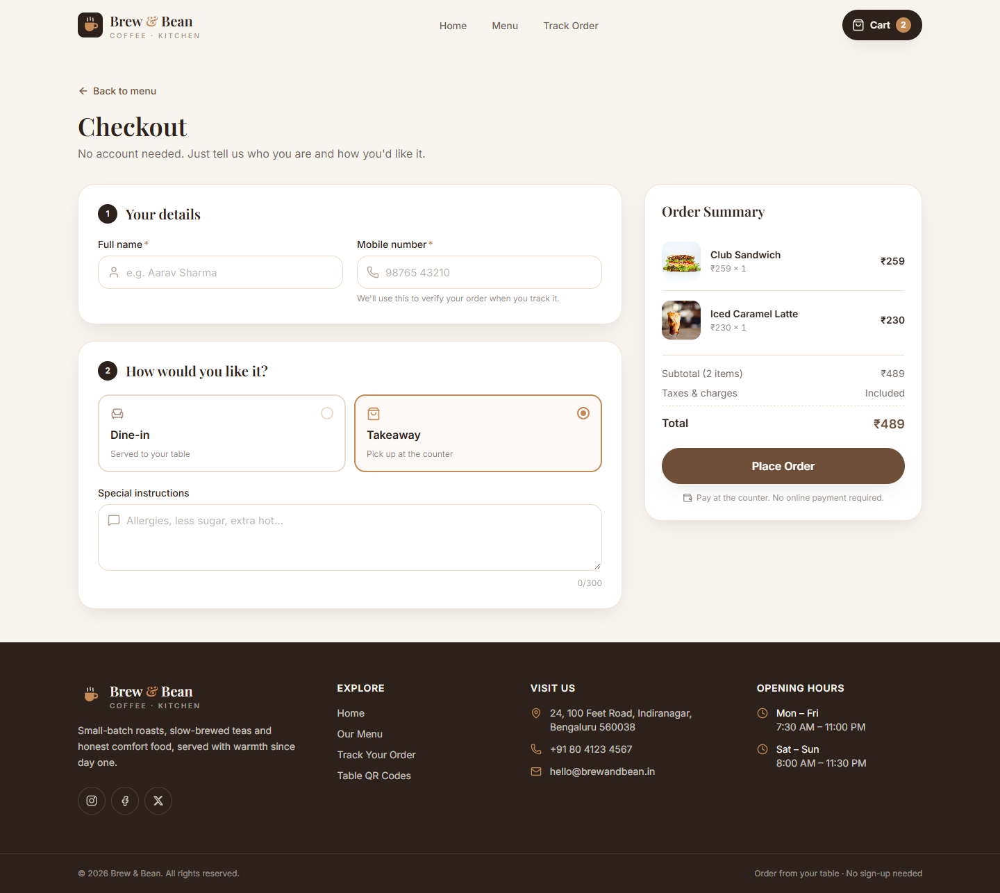
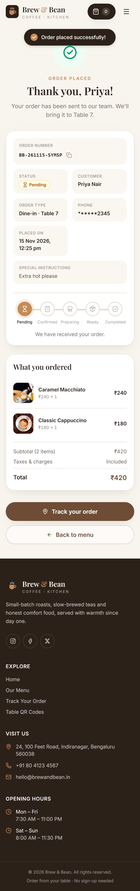
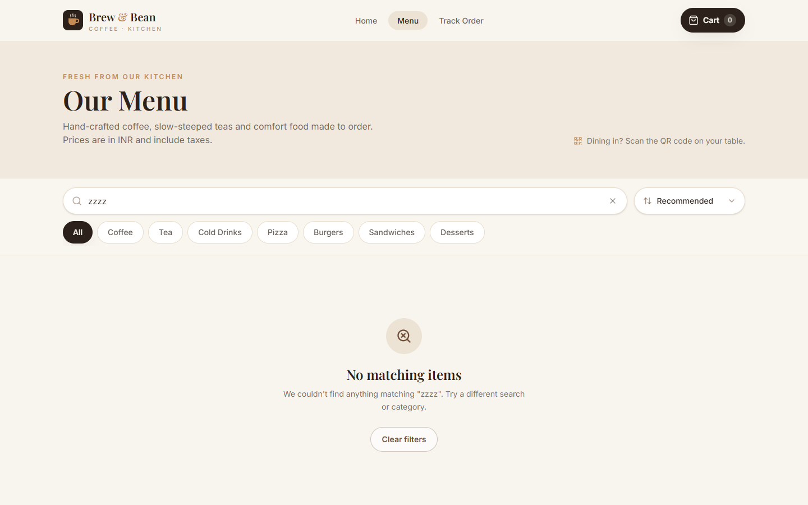

# Brew & Bean – Cafe Menu & Order Management System

A full-stack MERN application for a specialty coffee shop. Guests scan a QR code on their table, browse the live menu, build a cart and place an order without signing up. They can then follow the order's status using their order number and phone number. The backend exposes a documented REST API (Swagger) with full menu CRUD and order management.


---

## Table of contents

1. [Objectives](#objectives)
2. [Features](#features)
3. [Technology stack](#technology-stack)
4. [Folder structure](#folder-structure)
5. [Prerequisites](#prerequisites)
6. [MongoDB Atlas setup](#mongodb-atlas-setup)
7. [Backend setup](#backend-setup)
8. [Frontend setup](#frontend-setup)
9. [Environment variables](#environment-variables)
10. [Seed data](#seed-data)
11. [Running locally](#running-locally)
12. [API reference](#api-reference)
13. [Swagger documentation](#swagger-documentation)
14. [Testing](#testing)
15. [Deployment](#deployment)
16. [Screenshots](#screenshots)
17. [Live links & repository](#live-links--repository)
18. [Known limitations](#known-limitations)

---

## Objectives

- Let customers order from their table by scanning a QR code, with **no registration or login**.
- Serve a **dynamic menu from MongoDB** with search, category filters, price sorting and pagination.
- Provide a persistent shopping cart, a validated checkout, an order confirmation and order tracking.
- Calculate prices and totals **only on the server** using current menu prices, never trusting the client.
- Offer complete, documented **Menu CRUD and order-management REST APIs**, testable from Swagger UI or Postman.
- Keep the code modular, secure and easy to deploy (Render + Vercel + MongoDB Atlas).

## Features

### Customer website
- **Home page:** hero section, featured items (loaded from the API), popular categories, about section, "how QR ordering works" and a footer with contact details, opening hours and social links.
- **Menu page:**
  - Live data from MongoDB, with no hard-coded menu.
  - Debounced, case-insensitive name search.
  - Category chips (All, Coffee, Tea, Cold Drinks, Pizza, Burgers, Sandwiches, Desserts).
  - Price sorting: Recommended, Low to High, High to Low.
  - Pagination.
  - Loading skeletons, plus error (with retry), empty and no-results states.
  - Filters are kept in the URL, so they're shareable and survive a refresh.
- **Product cards:** image (with a branded fallback if it fails to load), name, description, category, INR price, availability badge, and an add-to-cart button that turns into an inline quantity stepper. Sold-out items can't be added.
- **Cart (React Context):**
  - Add, increase, decrease, remove and clear (with a confirmation modal).
  - Item count and totals derived in one utility.
  - Saved in `localStorage` and synced across tabs.
  - Slide-over cart drawer, plus a floating "View cart" bar on mobile.
- **QR table ordering:**
  - `/menu?table=5` sets the table number (validated 1–100) for the session.
  - The table number shows in the navbar, on the menu and at checkout.
  - The `/table-qr` page generates printable or downloadable QR codes for a range of tables.
- **Checkout (Formik + Yup):**
  - Name, Indian mobile number, dine-in or takeaway, table number (prefilled from the QR code, required for dine-in only) and special instructions.
  - Guards against an empty cart and duplicate submissions (a ref lock plus a disabled button).
  - Loading state, toasts, and inline API errors, including a one-click "remove unavailable items".
  - The cart is cleared only after the order succeeds.
- **Order confirmation:**
  - Shows the order number (with a copy button), customer, items and quantities, total, table, status and a progress tracker.
  - Survives a page refresh within the same browser session.
- **Order tracking:**
  - Look up an order by order number and phone number; the server verifies both.
  - Shows a status progress bar (Pending → Confirmed → Preparing → Ready → Completed, with Cancelled handled separately), items, total and date.
  - Includes a refresh button.
- **Responsive and accessible:** mobile-first layouts, keyboard support (Escape closes the drawer and modals), ARIA labels, a skip link and reduced-motion support.

### Backend API
- Layered architecture: **routes → controllers → services → models**.
- Full **Menu CRUD**, with search, category filter, availability and featured filters, sorting and pagination.
- **Order creation:**
  - Merges duplicate lines and loads current prices from MongoDB.
  - Rejects missing or unavailable items with HTTP 409 and per-item errors.
  - Stores name and price snapshots, calculates subtotal and total on the server, and generates a unique order number (`BB-YYMMDD-XXXXX`, retried on collision).
- **Order tracking** requires both the order number and the phone number. The response is a public view with the phone masked and no internal IDs.
- **Management endpoints** (menu create, update and delete; list orders; get an order; update status) require an `x-api-key` header.
- Completed and Cancelled are final statuses and can't be changed.
- Consistent JSON responses, centralized error handling, `express-validator` on every input, Helmet, a CORS allow-list, rate limiting and Mongoose `sanitizeFilter`.
- Swagger UI at `/api/docs` and a health check at `/api/health`.

## Technology stack

| Layer | Technologies |
| --- | --- |
| Frontend | React 19, Vite 8, Tailwind CSS 4 (`@tailwindcss/vite`), React Router DOM 7, Axios, React Context API, Formik, Yup, Lucide React, React Hot Toast, qrcode.react |
| Backend | Node.js (≥ 20), Express 5, Mongoose 9, express-validator, Helmet, CORS, express-rate-limit, swagger-jsdoc, swagger-ui-express, dotenv |
| Database | MongoDB Atlas |
| Tooling | nodemon, Postman / Swagger UI, Render, Vercel, cron-job.org |

## Folder structure

```
cafe-menu-order-management/
├── backend/
│   ├── config/
│   │   ├── constants.js          # categories, statuses, limits, sort options
│   │   ├── db.js                 # Mongoose connection
│   │   ├── env.js                # dotenv loading + required-variable checks
│   │   └── swagger.js            # OpenAPI definition (swagger-jsdoc)
│   ├── controllers/              # HTTP layer: read validated input, send responses
│   │   ├── menuController.js
│   │   └── orderController.js
│   ├── middleware/
│   │   ├── errorMiddleware.js    # 404 + centralized error handler
│   │   ├── rateLimiters.js       # API, order-creation and tracking limiters
│   │   ├── requireManagementKey.js
│   │   └── validateRequest.js    # runs express-validator, exposes req.validated
│   ├── models/
│   │   ├── Menu.js
│   │   └── Order.js
│   ├── routes/                   # endpoints + Swagger annotations
│   │   ├── healthRoutes.js
│   │   ├── menuRoutes.js
│   │   └── orderRoutes.js
│   ├── scripts/
│   │   ├── apiSmokeTest.js       # end-to-end API checks
│   │   └── seedMenu.js           # idempotent seed (26 items)
│   ├── services/                 # business logic + database access
│   │   ├── menuService.js
│   │   └── orderService.js
│   ├── utils/
│   │   ├── ApiError.js
│   │   ├── apiResponse.js
│   │   ├── asyncHandler.js
│   │   ├── generateOrderNumber.js
│   │   └── phone.js
│   ├── validators/
│   │   ├── commonValidators.js
│   │   ├── menuValidator.js
│   │   └── orderValidator.js
│   ├── app.js                    # Express app (middleware, routes, docs)
│   ├── server.js                 # DB connect, listen, graceful shutdown
│   ├── .env.example
│   └── package.json
├── frontend/
│   ├── public/favicon.svg
│   ├── src/
│   │   ├── assets/{icons,images}/        # logo mark, image fallback
│   │   ├── components/
│   │   │   ├── cart/        CartDrawer, CartItem, CartSummary, MobileCartBar
│   │   │   ├── checkout/    CheckoutForm, OrderSummary
│   │   │   ├── common/      Navbar, Footer, Button, Input, Modal, Loader, ErrorMessage,
│   │   │   │                EmptyState, QuantitySelector, Badge, SmartImage, Pagination,
│   │   │   │                TableBadge, Logo, SocialIcons
│   │   │   ├── home/        HeroSection, FeaturedItems, CategoryShowcase, AboutSection,
│   │   │   │                HowItWorks, SectionHeading
│   │   │   ├── menu/        MenuCard, MenuList, SearchBar, CategoryFilter, PriceSort
│   │   │   ├── order/       OrderConfirmation, OrderStatus, OrderDetails, TrackOrderForm
│   │   │   └── qr/          TableQrCode
│   │   ├── context/CartContext.jsx
│   │   ├── hooks/           useCart, useMenuItems, useDebounce, useTableFromUrl,
│   │   │                    useLockBodyScroll, useScrollToTop, useDocumentTitle
│   │   ├── pages/           HomePage, MenuPage, CheckoutPage, OrderConfirmationPage,
│   │   │                    OrderTrackingPage, TableQrPage, NotFoundPage
│   │   ├── routes/AppRoutes.jsx          # lazy-loaded secondary routes
│   │   ├── services/        api.js (Axios instance), menuService.js, orderService.js
│   │   ├── utils/           constants, formatCurrency, formatDate, cartUtils, storage
│   │   ├── App.jsx
│   │   ├── main.jsx
│   │   └── index.css                     # Tailwind v4 theme tokens
│   ├── index.html
│   ├── vercel.json                       # SPA rewrites
│   ├── vite.config.js
│   ├── .env.example
│   └── package.json
├── screenshots/
├── render.yaml                           # Render blueprint for the API
├── .gitignore
└── README.md
```

## Prerequisites

- **Node.js 20 or newer** (developed and tested on Node 24) and npm.
- A **MongoDB Atlas** account (free M0 cluster is enough). For purely local development you can also use a local MongoDB server.
- Git, plus optionally Postman.

## MongoDB Atlas setup

1. Sign in at <https://cloud.mongodb.com> and **create a project**, then **Build a Database → M0 (Free)**.
2. **Database Access → Add New Database User:** choose password authentication and give the user *Read and write to any database*. Save the username and password.
3. **Network Access → Add IP Address:**
   - For local development, add your current IP.
   - For Render, add `0.0.0.0/0`. Render's free instances don't have fixed outbound IPs, so keep the database user's password strong.
   - If the backend logs **"MongoDB Atlas refused this machine's IP address"** (or `SSL alert number 80`), your public IP changed. This happens often on Indian broadband and mobile hotspots. Add the new IP again. In development the backend retries every 10 seconds, so it connects by itself about a minute after you save the change in Atlas.
4. **Database → Connect → Drivers** and copy the connection string. Insert your password and a database name:
   ```
   mongodb+srv://<user>:<password>@<cluster>.mongodb.net/brew_and_bean?retryWrites=true&w=majority
   ```
   URL-encode special characters in the password (for example, `@` becomes `%40`). **Include the database name (`/brew_and_bean`) before the `?`.** Without it, Atlas silently uses a database called `test`, and the menu will look empty until you seed that one.
5. Put this value in `backend/.env` as `MONGODB_URI`. Never commit it.

## Backend setup

```bash
cd backend
npm install
cp .env.example .env        # Windows PowerShell: Copy-Item .env.example .env
# edit .env: set MONGODB_URI (and MANAGEMENT_API_KEY)
npm run seed                # insert / refresh the sample menu
npm run dev                 # http://localhost:5000  (nodemon)
```

Scripts: `npm start` (production), `npm run dev` (auto-reload), `npm run seed`, `npm run test:api`.

## Frontend setup

```bash
cd frontend
npm install
cp .env.example .env        # VITE_API_BASE_URL=/api  (Vite proxies /api to the backend)
npm run dev                 # http://localhost:5173  (plus a Network URL for phones)
```

Scripts: `npm run dev`, `npm run build` (output in `dist/`), `npm run preview`.

## Environment variables

### `backend/.env`

| Variable | Required | Example | Purpose |
| --- | --- | --- | --- |
| `PORT` | no | `5000` | HTTP port (Render injects its own). |
| `NODE_ENV` | no | `development` / `production` | Production hides stack traces and requires a management key. |
| `MONGODB_URI` | **yes** | `mongodb+srv://…/brew_and_bean` | MongoDB Atlas connection string. |
| `CLIENT_URL` | yes | `http://localhost:5173` | Allowed CORS origin(s), comma-separated (for example, local and Vercel URLs). |
| `MANAGEMENT_API_KEY` | prod: **yes** | long random string | Secret for management endpoints, sent as the `x-api-key` header. If it's unset in development, management endpoints are open and a warning is logged. If it's unset in production, the server refuses to start. |
| `TRUST_PROXY` | no | `1` on Render | Number of proxies in front of the app, so rate limiting sees real client IPs. |

To generate a key, run `node -e "console.log(require('crypto').randomBytes(32).toString('hex'))"`.

### `frontend/.env`

| Variable | Example | Purpose |
| --- | --- | --- |
| `VITE_API_BASE_URL` | Local: `/api`. Vercel: `https://<service>.onrender.com/api` | Base URL of the backend API. Locally, keep `/api`: the Vite dev server forwards it to the backend, so the app works on any port (5173, 5174, …) and from phones on your Wi-Fi without CORS issues. |
| `DEV_API_PROXY_TARGET` | `http://localhost:5000` | Development only: where Vite forwards `/api` requests. |

> If you see **"Unable to reach Brew & Bean"** while the Network tab shows `200 OK`, the browser blocked a cross-origin response. Keep `VITE_API_BASE_URL=/api` locally. In production, make sure `CLIENT_URL` on the backend contains your exact Vercel URL.

Real `.env` files are git-ignored; only the `.env.example` files are committed. The frontend never holds the management key.

## Seed data

```bash
cd backend
npm run seed
```

This inserts **26 menu items** across all 7 categories with realistic INR prices and verified Unsplash photos. Eight are marked *featured* (for the home page) and one, Mixed Berry Smoothie, is *unavailable* so you can see that state in the UI. The script **upserts by name** (case-insensitive unique index), so running it repeatedly never creates duplicates; it refreshes the existing items instead. If an image URL ever stops working, the UI swaps in a branded placeholder.

## Running locally

Use two terminals:

```bash
# terminal 1
cd backend && npm run dev
# terminal 2
cd frontend && npm run dev
```

| URL | What |
| --- | --- |
| http://localhost:5173 | Customer website |
| http://localhost:5173/menu?table=5 | Menu as a guest at table 5 (what a QR code opens) |
| http://localhost:5173/table-qr | QR code generator for table stands |
| http://localhost:5000/api/docs | Swagger UI |
| http://localhost:5000/api/health | Health check |

## API reference

Base URL: `http://localhost:5000/api` (production: `https://<your-render-service>.onrender.com/api`).

| Method | Endpoint | Access | Description |
| --- | --- | --- | --- |
| GET | `/health` | public | Service and database status |
| GET | `/menu` | public | List items. Query: `search`, `category`, `sort` (`default`, `price_asc`, `price_desc`, `newest`), `available`, `featured`, `page`, `limit` (≤100) |
| GET | `/menu/:id` | public | Get one menu item |
| POST | `/menu` | 🔑 management | Create a menu item |
| PUT | `/menu/:id` | 🔑 management | Update any subset of fields |
| DELETE | `/menu/:id` | 🔑 management | Delete a menu item (past orders keep their snapshots) |
| POST | `/orders` | public, rate-limited | Place an order (server-side pricing) |
| GET | `/orders/track?orderNumber=&phone=` | public, rate-limited | Track an order; both values must match |
| GET | `/orders` | 🔑 management | List orders (`status`, `page`, `limit`), newest first |
| GET | `/orders/:id` | 🔑 management | Full order record |
| PATCH | `/orders/:id/status` | 🔑 management | Update status: `Pending`, `Confirmed`, `Preparing`, `Ready`, `Completed`, `Cancelled` |

🔑 = send the `x-api-key: <MANAGEMENT_API_KEY>` header.

**Response format**

```json
{ "success": true, "message": "Order placed successfully", "data": {} }
```
```json
{ "success": false, "message": "Validation failed",
  "errors": [{ "field": "phone", "location": "body", "message": "Enter a valid 10-digit Indian mobile number" }] }
```

List endpoints also return `meta.pagination` (`page`, `limit`, `total`, `totalPages`, `hasNextPage`, `hasPrevPage`).

**Example: place an order**

```bash
curl -X POST http://localhost:5000/api/orders \
  -H "Content-Type: application/json" \
  -d '{
    "customerName": "Aarav Sharma",
    "phone": "+91 98765 43210",
    "orderType": "dine-in",
    "tableNumber": 5,
    "specialInstructions": "Less sugar please",
    "items": [{ "menuItem": "<menu item _id>", "quantity": 2 }]
  }'
```

Any `price` sent by a client is ignored. The server loads current prices from MongoDB.

**Status codes used:** 200, 201, 400 (validation, bad ObjectId, invalid JSON), 401 (missing or invalid key), 403 (management disabled), 404, 409 (unavailable items, duplicate name, final order status), 413, 429 (rate limit), 500, 503 (database unavailable).

**Rate limits (per IP):**
- 500 API requests per 15 minutes.
- 15 *successful* orders per 10 minutes.
- 20 *failed* tracking lookups per 10 minutes.

## Swagger documentation

- UI: **`/api/docs`** (for example, <http://localhost:5000/api/docs>)
- Raw OpenAPI JSON: `/api/docs.json`

Every endpoint is documented with parameters, request bodies, example payloads and success and error responses. To call management endpoints, click **Authorize** and enter your `MANAGEMENT_API_KEY`. The setting persists across page reloads. To use Postman, import `/api/docs.json`.

## Testing

A full manual test plan (about 120 cases covering every flow, the APIs, the phone/QR flow and deployment) is in **[TEST_CASES.md](TEST_CASES.md)**.

### Testing on a phone (QR codes)

A phone can't open `http://localhost:5173`, because on the phone "localhost" means the phone itself. To test QR ordering locally:

1. Connect the phone to the **same Wi-Fi** as your PC.
2. Run `npm run dev` in `frontend/` and note the **Wi-Fi** `Network:` URL Vite prints (for example, `http://10.190.105.1:5173`). Ignore VirtualBox or VMware addresses.
3. Open `http://localhost:5173/table-qr` on the PC. The URL field is pre-filled with that Wi-Fi address. Scan a code with the phone camera.
4. If the phone still can't connect, allow Node.js through Windows Firewall. Run this in an **admin** PowerShell:
   ```powershell
   New-NetFirewallRule -DisplayName "Brew & Bean dev (5173)" -Direction Inbound -Protocol TCP -LocalPort 5173 -Action Allow -Profile Private,Public
   ```
5. After deploying, generate the QR codes on the live Vercel site instead. They then work from anywhere, including on mobile data.

### Automated checks

**Automated API smoke test** (with the backend running and seeded):

```bash
cd backend
npm run test:api        # or: API_BASE_URL=https://<render-app>.onrender.com/api npm run test:api
```

It runs 54 checks:
- Health check.
- Listing, search (case-insensitive, regex-safe), category filter, both price sorts and pagination.
- Menu CRUD, including auth, validation, duplicate-name and invalid-JSON cases.
- Order validation: phone, table, quantity, operator injection, and unavailable or unknown items.
- Server-side totals, line merging and phone masking.
- Tracking with right and wrong phone numbers.
- Management listing, status updates and final-state locking.
- 404 handling.

The test creates and then deletes a temporary menu item and places two real orders. It reads `MANAGEMENT_API_KEY` from `backend/.env`. Because order creation is rate-limited to 15 successful orders per IP per 10 minutes, running it many times in a row will eventually return 429s; wait or restart the server.

**Manual checklist**

1. Open `/menu?table=5`. A "Table 5" badge appears in the navbar and on the menu.
2. Search "latte", pick a category and change the sort. The results and URL update.
3. Add items, change quantities and refresh the page. The cart persists.
4. Try adding the sold-out *Mixed Berry Smoothie*. The button is disabled.
5. At checkout, submit the empty form to see validation errors. Then fill it in and click **Place Order** quickly several times; only one order is created.
6. On the confirmation page, note the order number and click **Track your order**. The status shows *Pending*.
7. In Swagger, `PATCH /orders/{id}/status` with `{ "status": "Preparing" }`, then click **Refresh** on the tracking page.
8. Track with the wrong phone number. You get a generic "No order matches" message.
9. Check on a phone or in DevTools device mode: mobile layout, floating cart bar and cart drawer.

The UI flow above was also verified with an automated headless-browser run (30 checks, including mobile viewport overflow and the duplicate-submit test) during development.

## Deployment

### 1. Backend on Render

1. Push the repository to GitHub.
2. In Render, choose **New → Blueprint**, select the repo and Render reads `render.yaml`. Alternatively, choose **New → Web Service** with:
   - Root directory: `backend`
   - Build command: `npm ci`
   - Start command: `npm start`
   - Health check path: `/api/health`
3. Set the environment variables:
   - `NODE_ENV=production`
   - `TRUST_PROXY=1`
   - `MONGODB_URI=<Atlas URI>`
   - `CLIENT_URL=https://<your-app>.vercel.app` (comma-separate multiple origins)
   - `MANAGEMENT_API_KEY=<long random secret>` (the blueprint generates one)
4. Deploy, then open `https://<service>.onrender.com/api/health` and `/api/docs`.
5. Seed the production database once from your machine: temporarily point `backend/.env` at the Atlas URI and run `npm run seed`.

### 2. Frontend on Vercel

1. In Vercel, choose **Add New → Project**, import the repo and set **Root Directory** to `frontend`. The framework preset is Vite: build with `npm run build` and output to `dist`.
2. Add the environment variable `VITE_API_BASE_URL=https://<service>.onrender.com/api`. It's applied at build time, so redeploy after changing it.
3. Deploy. `vercel.json` rewrites every path to `index.html`, so deep links such as `/menu?table=3` or `/track-order` work after a refresh.
4. Add the final Vercel URL to the backend's `CLIENT_URL` on Render and redeploy the backend.
5. Open `/table-qr` on the live site, keep the website URL set to your Vercel domain, and print the table codes.

### 3. Health-check cron (optional)

Render's free web services spin down after about 15 minutes without traffic, and the first request after that can take around a minute while the instance starts. To reduce cold starts:

1. Create a free account at <https://cron-job.org> and add a **cron job**.
2. Set the URL to `https://<service>.onrender.com/api/health`, the method to GET, and the schedule to every 10–14 minutes.
3. Turn on failure notifications so you hear about downtime. The endpoint returns HTTP 503 if the database is disconnected.

**Important:** a periodic ping makes cold starts less likely, but it doesn't guarantee continuous availability:
- Free instances have a monthly usage allowance (instance hours), and pinging uses it up.
- Render can still restart or suspend instances.
- Render's terms and plans change over time.

For guaranteed always-on hosting, use a paid Render instance. The frontend's Axios timeout (30 s) and its "server may be waking up" message are designed with cold starts in mind.

## Screenshots

Real screenshots captured from the running application (local backend with seeded data):

| | |
| --- | --- |
|  Home (desktop) |  Home (mobile) |
|  Menu with QR table |  Menu (mobile, table 7) |
|  Cart drawer |  Checkout |
|  Checkout validation |  Order confirmation |
|  Order tracking |  Table QR generator |
|  No search results |  Swagger UI |

After deploying, you may want to replace these with screenshots of the live site.

## Live links & repository

Fill these in after deploying. They're intentionally left as placeholders rather than invented URLs.

- **Frontend (Vercel):** `https://<your-app>.vercel.app`
- **Backend API (Render):** `https://<your-service>.onrender.com/api`
- **Swagger docs:** `https://<your-service>.onrender.com/api/docs`
- **GitHub repository:** `https://github.com/<your-username>/cafe-menu-order-management`

## Known limitations

- **No admin dashboard or authentication, by design.** Management operations are done through Swagger UI or Postman, protected by a single shared API key rather than per-user accounts.
- **No payments:**
  - Orders are "pay at the counter".
  - Totals equal the subtotal because menu prices are tax-inclusive.
  - No preparation-time estimate is shown, because none is configured.
- **Order status is not pushed in real time.** Customers press **Refresh** on the tracking page (no WebSockets or polling).
- **Confirmation page and refresh.** It shows full details from the same browser session. In a different browser, customers use order tracking (number + phone), which deliberately avoids exposing orders by ID.
- **Rate limits are kept in memory.** They are per instance and reset on restart; a multi-instance deployment would need a shared store such as Redis.
- **Images are hot-linked from Unsplash.** They are free to use under the Unsplash licence. Production menus may prefer their own CDN.
- **Contact details are sample values.** The address, phone, email and social links in `frontend/src/utils/constants.js` should be replaced with the cafe's real details.
- **No Docker configuration.** The optional Docker setup wasn't added, to keep the scope on the mandatory requirements; the project runs with plain Node.
- **npm audit** reports moderate advisories in transitive `glob`/`minimatch` dependencies of `swagger-jsdoc` and `nodemon`. They only process the project's own files at startup or in development, and no non-breaking fix is available yet.
