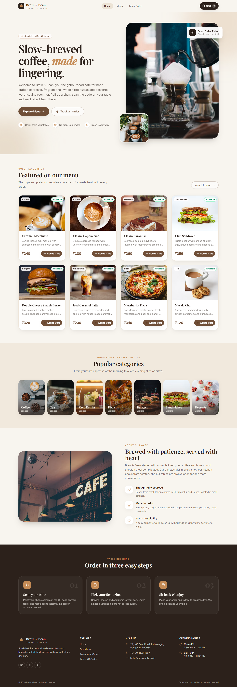
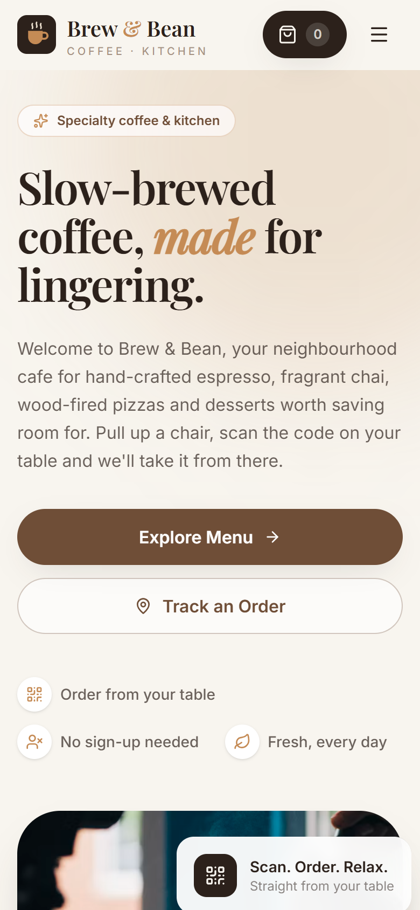
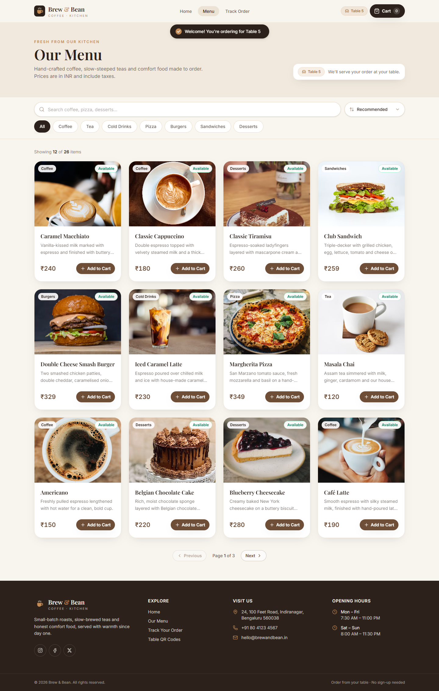
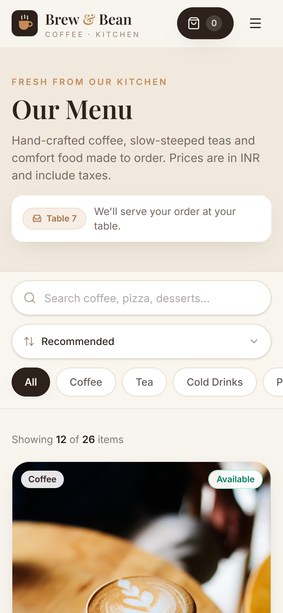
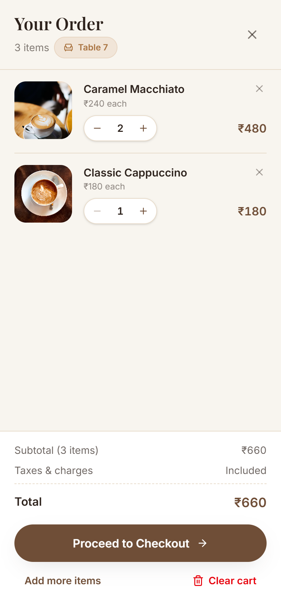
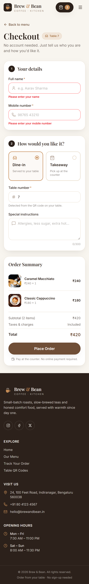
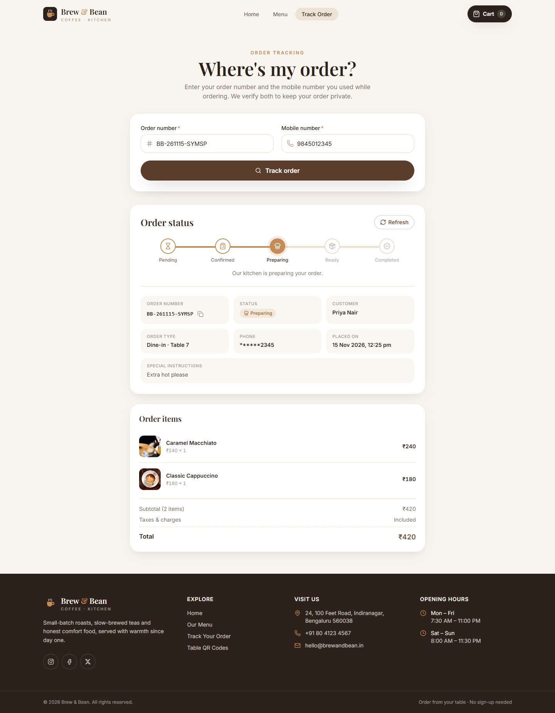
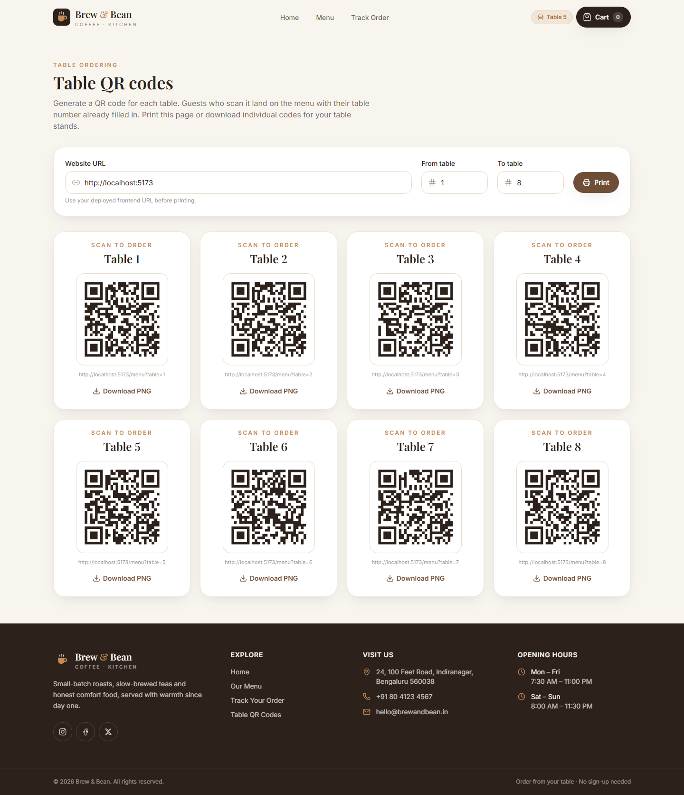
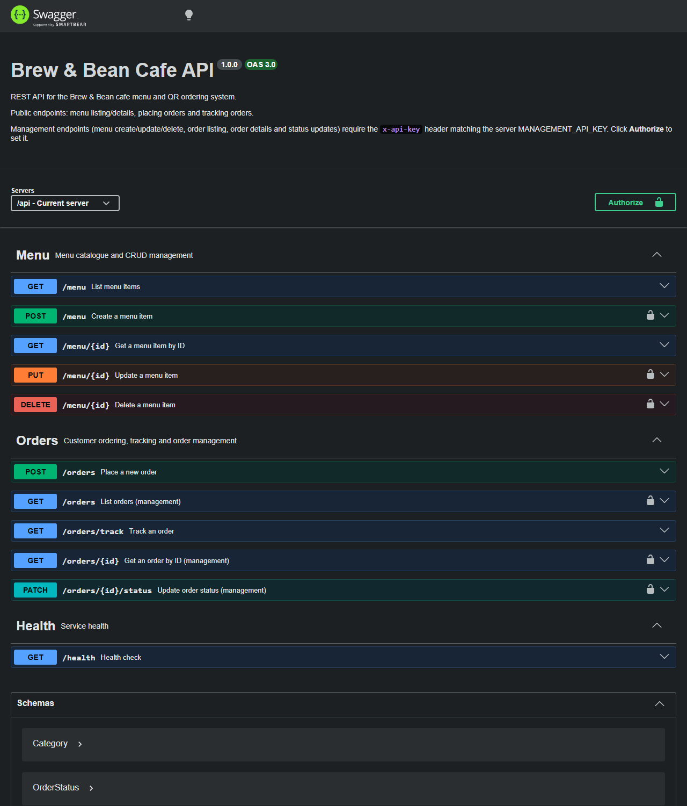

# Brew & Bean – Cafe Menu & Order Management System

A MERN web app for a coffee shop. Customers scan the QR code on their table, browse the menu, add items to a cart and place an order without creating an account. They can then track their order with the order number and phone number.



## Live links

| | Link |
| --- | --- |
| **Frontend** (Vercel) | https://cafe-menu-order-management.vercel.app |
| **Backend API** (Render) | https://brew-and-bean-api-qqi9.onrender.com/api |
| API documentation (Swagger) | https://brew-and-bean-api-qqi9.onrender.com/api/docs |
| API health check | https://brew-and-bean-api-qqi9.onrender.com/api/health |
| Table QR codes | https://cafe-menu-order-management.vercel.app/table-qr |
| Source code (GitHub) | https://github.com/yashchevli18/cafe-menu-order-management |

> The API runs on Render's free plan, so the first request after a period of inactivity can take up to a minute.

## Tech stack

| Part | Technologies |
| --- | --- |
| Frontend | React 19, Vite, Tailwind CSS 4, React Router, Axios, Context API, Formik + Yup, Lucide React, React Hot Toast, qrcode.react |
| Backend | Node.js, Express 5, Mongoose, express-validator, Helmet, CORS, express-rate-limit, Swagger (swagger-jsdoc + swagger-ui-express) |
| Database | MongoDB Atlas |
| Hosting | Vercel (frontend), Render (backend) |

## Run locally

**Requirements:** Node.js 20+ and a MongoDB Atlas connection string.

### 1. Backend

```bash
cd backend
npm install
```

Create `backend/.env` from the example file:

```bash
cp .env.example .env        # Windows PowerShell: Copy-Item .env.example .env
```

Then edit `backend/.env`:

| Variable | Value |
| --- | --- |
| `MONGODB_URI` | Your MongoDB Atlas connection string, with the database name `brew_and_bean` before the `?` |
| `CLIENT_URL` | Frontend address allowed to call the API (`http://localhost:5173` locally) |
| `MANAGEMENT_API_KEY` | Any long random string. Generate one with `node -e "console.log(require('crypto').randomBytes(32).toString('hex'))"` |

In MongoDB Atlas, under **Network Access**, allow your IP address (or `0.0.0.0/0`).

Then load the sample menu and start the API:

```bash
npm run seed     # adds 26 menu items (safe to run again)
npm run dev      # http://localhost:5000
```

### 2. Frontend

```bash
cd frontend
npm install
```

Create `frontend/.env` from the example file (no changes needed for local use):

```bash
cp .env.example .env        # Windows PowerShell: Copy-Item .env.example .env
npm run dev                 # http://localhost:5173
```

Locally, `VITE_API_BASE_URL=/api` is forwarded to the backend by Vite. For production on Vercel, set `VITE_API_BASE_URL` to the full Render API URL, e.g. `https://brew-and-bean-api-qqi9.onrender.com/api`.

Open http://localhost:5173. To simulate scanning a table QR code, open http://localhost:5173/menu?table=5.

## Useful URLs (local)

| URL | Purpose |
| --- | --- |
| http://localhost:5173 | Customer website |
| http://localhost:5173/table-qr | Generate QR codes for tables |
| http://localhost:5000/api/docs | Swagger API docs. Click **Authorize** and enter `MANAGEMENT_API_KEY` for menu create/update/delete and order management |
| http://localhost:5000/api/health | Health check |

## Scripts

| Folder | Command | What it does |
| --- | --- | --- |
| backend | `npm run dev` | Start the API with auto-reload |
| backend | `npm start` | Start the API (production) |
| backend | `npm run seed` | Insert or refresh the sample menu |
| backend | `npm run test:api` | Run the API smoke tests (API must be running) |
| frontend | `npm run dev` | Start the website |
| frontend | `npm run build` | Build the website for production |

## Screenshots

| | |
| --- | --- |
|  **Home page** |  **Home page (mobile)** |
|  **Menu: search, category filter, price sort** |  **Menu opened from a table QR code (Table 7)** |
|  **Cart** |  **Checkout** |
|  **Checkout form validation** |  **Order confirmation** |
|  **Order tracking** |  **Table QR code generator** |
|  **No search results state** |  **Swagger API documentation** |
